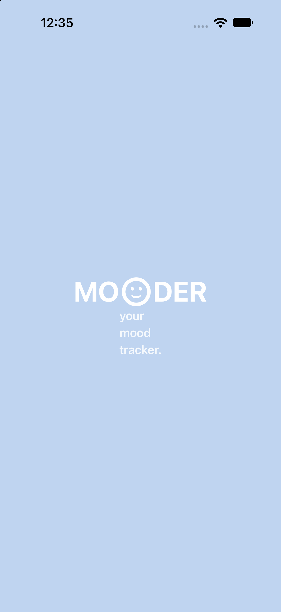
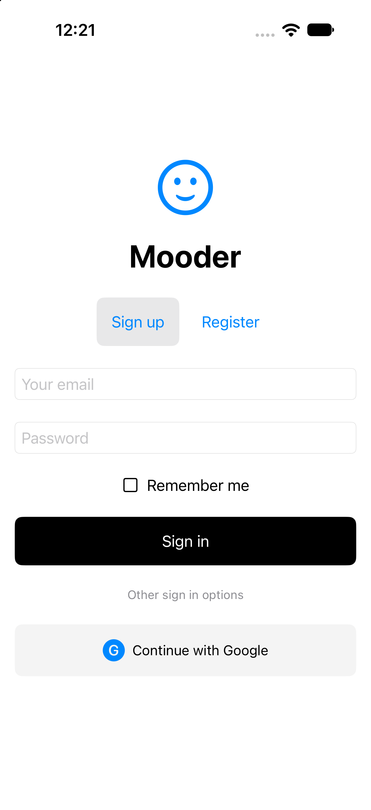
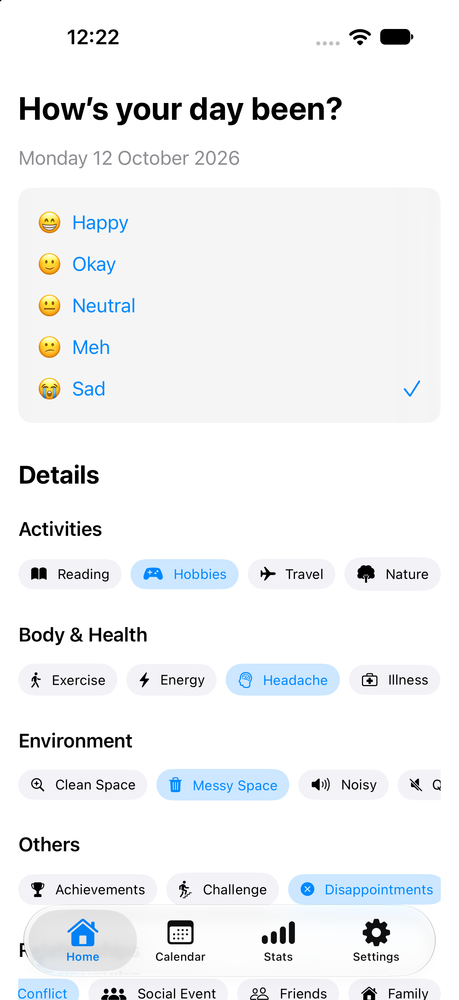
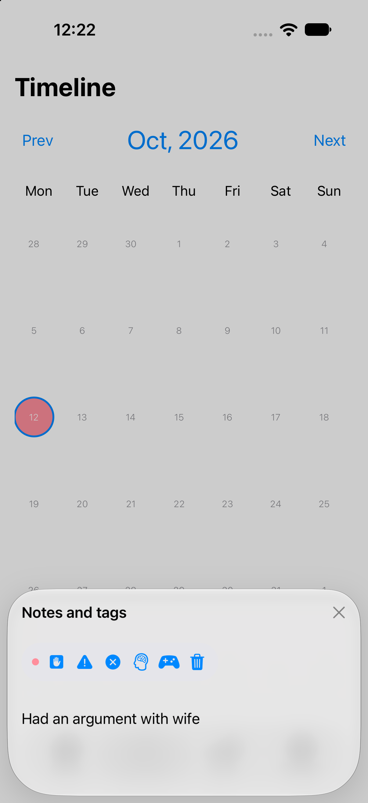
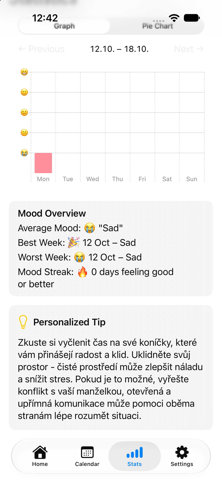
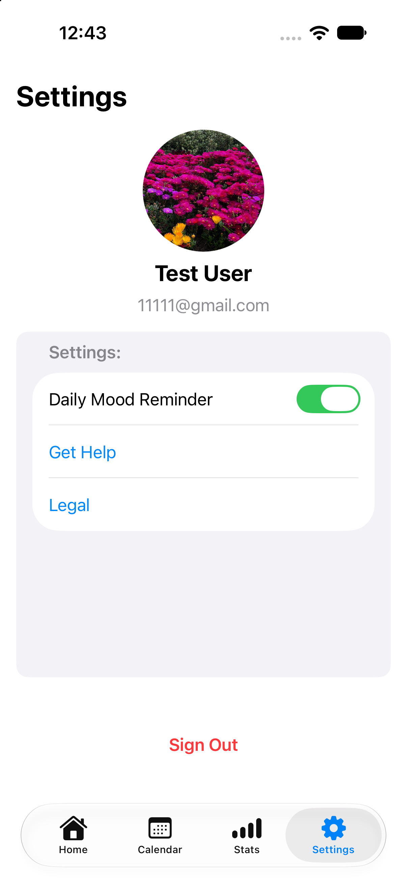

# Mooder - AI-Powered Mood Tracker

Mooder is a native iOS application designed to help users track their daily moods, activities, and well-being. By leveraging local persistence and cloud synchronization, along with AI-driven personalized insights, Mooder serves as a smart digital diary.

## Features

* **Smart Mood Tracking:** Log your daily mood on a scale from Happy to Sad and attach relevant tags (Activities, Body & Health, Environment, etc.).
* **Detailed Entries:** Add custom notes to your daily logs to keep a detailed journal.
* **Calendar Timeline:** Browse your past entries easily through an intuitive monthly calendar view.
* **AI-Powered Insights:** Get personalized tips and feedback generated by ChatGPT based on your recent mood trends.
* **Comprehensive Stats:** View your average mood, best/worst weeks, and current mood streak through interactive graphs and pie charts.
* **Seamless Authentication:** Secure user sign-in using Firebase Email/Password or Continue with Google.
* **Offline-First & Cloud Sync:** Data is saved locally using CoreData for offline access and synced to Firebase for cross-device availability.
* **Daily Reminders:** Customizable local notifications ensure you never forget to log your mood.

## Screenshots

  
  
  
  
  
  

## Tech Stack & Architecture

* **Platform:** Native iOS (Swift)
* **Architecture:** MVVM (Model-View-ViewModel) for clean separation of concerns and testability.
* **Local Storage:** CoreData
* **Backend & Sync:** Firebase (Authentication, Cloud Firestore)
* **AI Integration:** OpenAI API (ChatGPT) for personalized daily tips.
* **Other:** Local Notifications for daily reminders.
